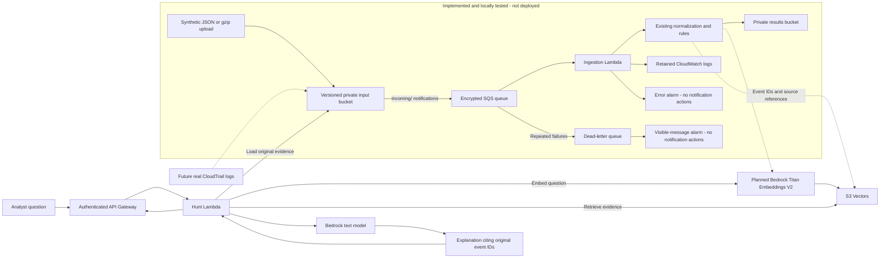

# TrailSleuth

TrailSleuth is a portfolio project exploring semantic threat hunting over AWS CloudTrail logs with Amazon Bedrock, Lambda, and Terraform.

CloudTrail records API activity, but finding related events across unfamiliar actions and identities can be difficult. The eventual goal is to help an analyst ask a question such as: **“Who stopped logging or created new credentials, and what other activity should I investigate?”** Answers should point back to original event IDs so the analyst can inspect the evidence.

**Milestone 2 implements ingestion code and Terraform configuration, tested locally but not deployed.** The CLI remains an offline, rule-based demo. There is no semantic search, model access, API, or frontend yet. Local tests use injected clients, not live AWS. Installing dependencies and building the deployment package may download packages.

| Capability | Implemented | Locally tested | Deployed / verified in AWS |
| --- | --- | --- | --- |
| CLI, normalization, two detection rules | Yes | Yes | Not applicable |
| Version-aware S3 → SQS → Lambda ingestion | Yes | Yes, with fake clients | No |
| Terraform resources and Lambda ZIP | Yes | Schema validation and isolated import | No |
| Bedrock, semantic retrieval, authenticated API | Planned | No | No |

## Local quickstart

Use Python 3.11 or newer for the CLI and tests. Use Python 3.12 for Lambda artifact verification, matching the selected runtime. On macOS with Homebrew, install it with `brew install python@3.12` if needed. Dependency installation requires package-download access; running the demo does not.

From the repository root:

```sh
python3.12 -m venv .venv
source .venv/bin/activate
python -m pip install -e '.[dev]'
python -m trailsleuth detect sample_data/cloudtrail_events.json
```

The equivalent installed command is `trailsleuth detect sample_data/cloudtrail_events.json`.

The five synthetic events produce two findings: `TS-001` (high) for successful `StopLogging` and `TS-002` (medium) for successful `CreateAccessKey`. Normal activity and the denied StopLogging attempt produce no findings. Output is a JSON object with `mode: "rule-based"`, `processed_events: 5`, and a `findings` array. Each finding includes a rule ID, event ID, reason, severity, and source reference.

These severities prioritize investigation. Both actions can be legitimate administration and do not alone prove compromise. A clean result also does not establish that activity is safe: only two rules exist.

## Current capabilities

- Validate CloudTrail `{"Records": [...]}` JSON and normalize event ID, timestamp, source, action, Region, identity, source IP, error details, and source reference.
- Accept missing optional fields and preserve nested identity data. Require event ID, timestamp with timezone, source, and action. Reject malformed inputs with record/field context before emitting any findings.
- Match rules by both AWS service and action. A populated error code or error message prevents a successful-change finding.
- Read a local JSON file and print structured findings in input order. Exit code `0` means processing succeeded, even if findings exist; `2` means invalid input or command usage.
- Ingest versioned JSON or gzip S3 objects from SQS notifications, preserving source bucket/key/version and reusing the same rules. Enforce 5 MiB download and 20 MiB decompressed limits.
- Write normalized events and findings together in one deterministic JSON result. Return only failed SQS message IDs so failures are retried and can reach the DLQ.
- Prepare private S3 storage, encrypted queues, scoped IAM, Lambda, retained logs, and two alarms in Terraform. No AWS resources have been deployed by this milestone.
- Run tests and static checks without AWS credentials. No remote Terraform backend is configured.

Fixtures are entirely synthetic. They use fictitious account IDs and identities, fixed event IDs, and documentation-only IP addresses. There are no access keys or other credentials in the fixtures. The original MIT license is preserved.

## Checks

```sh
python -m pytest
python -m ruff check .
python -m ruff format --check .
python scripts/build_lambda.py
python scripts/check_lambda_artifact.py
terraform -chdir=infra/terraform fmt -check -recursive
terraform -chdir=infra/terraform init -backend=false -input=false -lockfile=readonly
terraform -chdir=infra/terraform validate
```

Build before Terraform validation: the configuration hashes `build/lambda/ingestion.zip`. The archive includes the pinned AWS SDK and its dependencies, selected for Python 3.12/Linux ARM64. Generated files are ignored. The import check uses Python 3.12 with the source checkout and installed site-packages excluded.

Terraform installation and command explanations are in [Terraform basics](docs/terraform-basics.md). Initialization downloads provider metadata and needs network access, but these checks need no AWS credentials. Validation does not establish deployability. GitHub Actions runs Python 3.11/3.12 tests, packaging, and Terraform checks with read-only repository permissions and never deploys infrastructure.

## Delivery and retries

Each result key hashes the original bucket, decoded object key, and immutable version ID: `results/v1/<sha256>.json`. A duplicate notification recomputes the same output and overwrites that key. A repeated upload creates a new S3 version and a different result, even if the bytes are unchanged. Missing or null version IDs fail instead of processing a potentially newer object.

This is **idempotent result writing, not exactly-once execution**. A message succeeds only after all its result writes succeed. If a multi-object message partly succeeds, retrying safely rewrites the successful results too. There is no in-memory duplicate cache. Result bytes remain stable for the same input and processor version; a future rule/schema change needs an explicit reprocessing/versioning decision.

See the [deployment and operations guide](docs/deployment.md) for authentication, plan review, synthetic uploads, evidence lookup, DLQ recovery, costs, and cleanup. Its AWS mutation commands are for a future manual deployment; none were run for this milestone.

## Architecture — implemented configuration versus planned features



The lower semantic/API path is planned. First, deploy and verify synthetic ingestion manually. Then add embeddings and retrieval, evidence-grounded investigations, API authentication, evaluation, and portfolio polish. See the [roadmap](docs/roadmap.md). Account permissions, concurrency quota, Region, retention, and costs must be reviewed before deployment. Alarms currently expose state in CloudWatch only; there is no email or paging integration.

Log contents are untrusted data. Future model integrations must isolate retrieved text from instructions and defend against prompt injection. Semantic similarity is a retrieval signal, never proof of malicious activity.

## Repository guide

| Location | Purpose |
| --- | --- |
| `src/trailsleuth/` | Normalization, rules, CLI, and injectable ingestion handler |
| `tests/` | Parsing, detection, and command-line behavior |
| `sample_data/` | Synthetic CloudTrail fixtures |
| `infra/terraform/` | Ingestion resources, scoped IAM, outputs, and unchanged dependency lock |
| `scripts/` | Repeatable Lambda build and isolated import check |
| `requirements-lambda.txt` | Pinned Lambda SDK dependency closure |
| `docs/` | Terraform introduction, deployment guide, and roadmap |
| `.github/workflows/` | Credential-free checks |
| `AGENTS.md` | Project and contributor conventions |

## Commit this milestone

Review the changes before committing. The explicit paths avoid staging unrelated files:

```sh
git add README.md .gitignore AGENTS.md src tests scripts requirements-lambda.txt infra/terraform docs .github/workflows
git diff --cached --stat
git diff --cached
git commit -m "Add version-aware S3 SQS Lambda ingestion"
git push -u origin HEAD
```

Run the push command only when ready to publish to your configured `origin`. State, provider downloads, real variable files, credentials, and local environment files are ignored; examples and `.terraform.lock.hcl` remain trackable.
