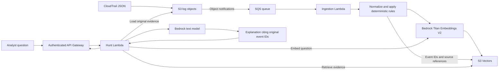

# TrailSleuth

TrailSleuth is a portfolio project exploring semantic threat hunting over AWS CloudTrail logs with Amazon Bedrock, Lambda, and Terraform.

CloudTrail records API activity, but finding related events across unfamiliar actions and identities can be difficult. The eventual goal is to help an analyst ask a question such as: **“Who stopped logging or created new credentials, and what other activity should I investigate?”** Answers should point back to original event IDs so the analyst can inspect the evidence.

**Milestone 1 implements local, rule-based detection only.** There is no semantic search, model access, deployed infrastructure, or frontend yet. Everything in the local demo runs without AWS credentials or network calls after installation.

## Local quickstart

Use Python 3.11 or newer. On macOS with Homebrew, install it with `brew install python@3.11` if needed. Dependency installation requires package-download access; running the demo does not.

From the repository root:

```sh
python3.11 -m venv .venv
source .venv/bin/activate
python -m pip install -e '.[dev]'
python -m trailsleuth detect sample_data/cloudtrail_events.json
```

The equivalent installed command is `trailsleuth detect sample_data/cloudtrail_events.json`.

The five synthetic events produce two findings: `TS-001` (high) for successful `StopLogging` and `TS-002` (medium) for successful `CreateAccessKey`. Normal activity and the denied StopLogging attempt produce no findings. Output is a JSON object with `mode: "rule-based"`, `processed_events: 5`, and a `findings` array. Each finding includes a rule ID, event ID, reason, severity, and source reference.

These severities prioritize investigation. Both actions can be legitimate administration and do not alone prove compromise. A clean result also does not establish that activity is safe: only two rules exist.

## Current capabilities

- Validate CloudTrail `{"Records": [...]}` JSON and normalize event ID, timestamp, source, action, Region, identity, source IP, error details, and source reference.
- Accept missing optional fields and preserve nested identity data. Require event ID, timestamp with timezone, source, and action. Reject malformed inputs with record/field context before emitting any findings.
- Match rules by both AWS service and action. A populated error code or error message prevents a successful-change finding.
- Read a local JSON file and print structured findings in input order. Exit code `0` means processing succeeded, even if findings exist; `2` means invalid input or command usage.
- Run tests and static checks without AWS credentials. Terraform contains provider configuration and variables only, with no resources, data sources, or backend.

Fixtures are entirely synthetic. They use fictitious account IDs and identities, fixed event IDs, and documentation-only IP addresses. There are no access keys or other credentials in the fixtures. The original MIT license is preserved.

## Checks

```sh
python -m pytest
python -m ruff check .
python -m ruff format --check .
terraform -chdir=infra/terraform fmt -check -recursive
terraform -chdir=infra/terraform init -backend=false -input=false
terraform -chdir=infra/terraform validate
```

Terraform installation and command explanations are in [Terraform basics](docs/terraform-basics.md). Initialization downloads the provider and needs network access, but these checks need no AWS credentials. Validation does not establish that a future deployment will succeed. GitHub Actions runs these checks with read-only repository permissions and never deploys infrastructure.

## Target architecture — planned, not deployed



Future work includes queued ingestion, embeddings and retrieval, evidence-grounded investigations, API authentication, evaluation, and portfolio polish. See the [roadmap](docs/roadmap.md). Model selection, Region availability, IAM, retention, and cost controls will be verified before cloud deployment.

Log contents are untrusted data. Future model integrations must isolate retrieved text from instructions and defend against prompt injection. Semantic similarity is a retrieval signal, never proof of malicious activity.

## Repository guide

| Location | Purpose |
| --- | --- |
| `src/trailsleuth/` | Normalization, pure detection rules, and CLI |
| `tests/` | Parsing, detection, and command-line behavior |
| `sample_data/` | Synthetic CloudTrail fixtures |
| `infra/terraform/` | Provider requirements, variables, and dependency lock |
| `docs/` | Terraform introduction and roadmap |
| `.github/workflows/` | Credential-free checks |
| `AGENTS.md` | Project and contributor conventions |

## Commit this milestone

Review the changes before committing. The explicit paths avoid staging unrelated files:

```sh
git add README.md .gitignore AGENTS.md pyproject.toml src tests sample_data infra/terraform docs .github/workflows
git diff --cached --stat
git diff --cached
git commit -m "Add TrailSleuth local detection foundation"
git push -u origin HEAD
```

Run the push command only when ready to publish to your configured `origin`. State, provider downloads, real variable files, credentials, and local environment files are ignored; examples and `.terraform.lock.hcl` remain trackable.
